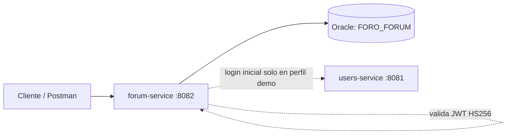

# Microservicio de Foro (`forum-service`)

Backend academico para Full Stack III correspondiente al microservicio **`forum-service`**. Desarrollado con Java 17, Spring Boot 3.5.7, Maven, Spring Data JPA, Spring Security y Oracle JDBC, organizado por capas conforme a la guia de aprendizaje.

## Alcance

| Microservicio | Puerto | Responsabilidad |
| --- | --- | --- |
| forum-service | 8082 | Categorias, busqueda, visualizacion, publicacion de temas y comentarios |

`common` es una biblioteca compartida de seguridad JWT, CORS y manejo global de errores, **no un microservicio independiente**.

| Actor | Privilegios en `forum-service` |
| --- | --- |
| Visitante | Leer categorias, temas y comentarios; buscar y filtrar temas |
| USER | Lo anterior; publicar temas, comentar y editar/eliminar sus propios temas y comentarios |
| ADMIN | Lo anterior; crear, actualizar y eliminar categorias; editar/eliminar cualquier tema o comentario |

Los DTO no admiten propiedades desconocidas: por ejemplo, enviar `authorId` en el cuerpo al publicar un tema o comentario devuelve `400 Bad Request`.

## Arquitectura



El servicio utiliza su propio esquema (`FORO_FORUM`), credenciales y tablas en Oracle. `author_id` almacena el identificador de usuario extraido del token JWT (`sub`), sin claves foraneas ni joins hacia el esquema de usuarios.

```text
common/                  Seguridad JWT, CORS y manejo global de errores
forum-service/
  src/main/java/cl/duoc/foro/forum/
    controller/          Endpoints REST (categorias, temas y comentarios)
    dto/                 Entradas validadas y respuestas
    entity/              Entidades JPA (Category, Topic, Comment)
    repository/          Repositorios Spring Data JPA
    service/             Reglas de negocio y verificacion de permisos
    config/              Carga de datos de demostracion (ForumDemoData)
database/                DDL Oracle del esquema FORO_FORUM y consultas de comprobacion
.github/workflows/       Compilacion y pruebas en GitHub Actions
```

## 1. Compilar y probar

Desde la carpeta raiz de `ForumService`, con JDK 17 y Maven 3.9 o superior:

```powershell
mvn clean package
```

O para ejecutar todas las pruebas automaticas:

```powershell
mvn verify
```

Genera el JAR ejecutable en `forum-service/target/forum-service-1.0.0-SNAPSHOT.jar`. Las pruebas usan **H2 en modo Oracle solo en test** y cubren JWT, CRUD, permisos, validaciones, filtros, asociaciones y carga de datos demo.

## 2. Preparar Oracle

Se requiere Oracle 19c o superior (incluye Oracle XE / Free y Autonomous Database).

1. Contar con el usuario/esquema `FORO_FORUM` creado en Oracle (con permisos `CREATE SESSION`, `CREATE TABLE`, `CREATE SEQUENCE` y cuota en su tablespace).
2. Conectarse como `FORO_FORUM` y ejecutar **`database/01-forum-schema.sql`** una sola vez sobre el esquema vacio.

El script crea las secuencias (`categories_seq`, `topics_seq`, `comments_seq`) y tablas del foro. Hibernate usa `ddl-auto: validate`: comprueba que el esquema coincida con las entidades JPA, sin crear ni borrar tablas.

| Esquema | Tabla | Registros iniciales con perfil `demo` |
| --- | --- | --- |
| FORO_FORUM | FORUM_CATEGORIES | 5 |
| FORO_FORUM | FORUM_TOPICS | 3 |
| FORO_FORUM | FORUM_COMMENTS | 3 |

Relaciones internas: una categoria tiene muchos temas y un tema tiene muchos comentarios. Las cinco categorias iniciales son: *Tecnologia*, *Videojuegos*, *Ciencia*, *Deportes* y *Cine y series*.

### Variables de entorno y valores por defecto

En `forum-service/src/main/resources/application.yml` estan definidos los siguientes parametros (puedes sobreescribirlos con variables de entorno si tu entorno cambia):

| Variable | Valor por defecto | Descripcion |
| --- | --- | --- |
| `FORUM_PORT` | `8082` | Puerto HTTP del microservicio |
| `FORUM_DB_URL` | `jdbc:oracle:thin:@localhost:1521/XEPDB1` | URL JDBC de Oracle |
| `FORUM_DB_USERNAME` | `FORO_FORUM` | Usuario del esquema en Oracle |
| `FORUM_DB_PASSWORD` | `forum2026` | Contrasena del esquema en Oracle |
| `JWT_SECRET` | `clave_secreta_jwt_para_tokens_de_al_menos_32_bytes_12345` | Clave secreta HS256 (minimo 32 bytes, debe coincidir con `users-service`) |
| `DEMO_USERS_URL` | `http://localhost:8081` | URL de `users-service` (usada solo al iniciar con perfil `demo`) |
| `DEMO_PASSWORD` | `Demo1234` | Clave de los usuarios demo para obtener sus IDs al poblar datos |

Si necesitas cambiar alguna variable en PowerShell antes de iniciar:

```powershell
$env:FORUM_DB_URL = 'jdbc:oracle:thin:@localhost:1521/XEPDB1'
$env:FORUM_DB_USERNAME = 'FORO_FORUM'
$env:FORUM_DB_PASSWORD = 'forum2026'
$env:JWT_SECRET = 'clave_secreta_jwt_para_tokens_de_al_menos_32_bytes_12345'
```

### Conexion Oracle Cloud con Wallet (opcional)

Si usas Oracle Autonomous Database con Wallet descomprimido localmente:

```powershell
$env:FORUM_DB_URL = 'jdbc:oracle:thin:@miinstancia_high?TNS_ADMIN=C:/ruta/Wallet_Foro'
```

## 3. Arrancar el servicio

> **Nota importante:** Si modificaste `application.yml` o el codigo fuente, recuerda ejecutar `mvn package -DskipTests` antes de volver a lanzar `java -jar` para que el JAR incluya los cambios.

### Con carga inicial de datos (`demo`)

Asegurate de que `users-service` este activo en `http://localhost:8081` con los usuarios demo creados (`admin@foro.test`, `ana@foro.test`, `luis@foro.test`). Luego ejecuta en PowerShell (con el argumento entre comillas):

```powershell
java -jar forum-service/target/forum-service-1.0.0-SNAPSHOT.jar "--spring.profiles.active=demo"
```

La carga demo se omite automaticamente si alguna de las tres tablas (`FORUM_CATEGORIES`, `FORUM_TOPICS` o `FORUM_COMMENTS`) ya contiene registros.

### Arranque normal (sin carga inicial)

Para arranques posteriores cuando la base de datos ya tiene datos (no requiere que `users-service` este encendido para iniciar):

```powershell
java -jar forum-service/target/forum-service-1.0.0-SNAPSHOT.jar
```

Para comprobar los datos cargados en Oracle, ejecuta las consultas de `FORUM_CATEGORIES`, `FORUM_TOPICS` y `FORUM_COMMENTS` incluidas en `database/02-check-data.sql` conectado como `FORO_FORUM`.

## Endpoints de `forum-service`

Todos los cuerpos son JSON (`Content-Type: application/json`). Los endpoints protegidos requieren el encabezado `Authorization: Bearer <accessToken>` emitido por `users-service`. Fechas de creacion en UTC.

| Metodo | Ruta | Acceso |
| --- | --- | --- |
| GET | `/api/categories` | Publico |
| GET | `/api/categories/{id}` | Publico |
| POST | `/api/categories` | ADMIN (`name`, `description`) |
| PUT | `/api/categories/{id}` | ADMIN (`name`, `description`) |
| DELETE | `/api/categories/{id}` | ADMIN (`409 Conflict` si tiene temas asociados) |
| GET | `/api/topics` | Publico (`q` por titulo, `categoryId`, `page`, `size`) |
| GET | `/api/topics/{id}` | Publico |
| POST | `/api/topics` | Autenticado (`title`, `content`, `categoryId`) |
| PUT | `/api/topics/{id}` | Autor del tema o ADMIN (`title`, `content`, `categoryId`) |
| DELETE | `/api/topics/{id}` | Autor del tema o ADMIN (elimina tambien sus comentarios) |
| GET | `/api/topics/{topicId}/comments` | Publico (paginado: `page`, `size`) |
| GET | `/api/topics/{topicId}/comments/{id}` | Publico |
| POST | `/api/topics/{topicId}/comments` | Autenticado (`content`) |
| PUT | `/api/topics/{topicId}/comments/{id}` | Autor del comentario o ADMIN (`content`) |
| DELETE | `/api/topics/{topicId}/comments/{id}` | Autor del comentario o ADMIN |

- **Paginacion:** `page` desde `0`, `size` de `1` a `100` (`20` por defecto).
- **Busqueda (`q`):** filtro por titulo sin distinguir mayusculas/minusculas; trata `%` y `_` como texto literal.
- **Codigos de respuesta:** `200 OK` (consulta/actualizacion), `201 Created` (creacion con encabezado `Location`), `204 No Content` (eliminacion), `400 Bad Request` (validacion/JSON invalido), `401 Unauthorized` (token ausente/invalido/expirado), `403 Forbidden` (sin permisos), `404 Not Found` (recurso inexistente), `409 Conflict` (nombre de categoria duplicado o categoria con temas al eliminar). Errores en formato `application/problem+json`.

## Seguridad

- Validacion de JWT firmado con **HS256**, verificando emisor (`foro-users`) y vigencia.
- Ambos microservicios deben usar el mismo valor en `JWT_SECRET` (al menos 32 bytes).
- CORS permite por defecto `http://localhost:3000`, configurable con `SECURITY_CORS_ORIGINS`.
- Sesion stateless (`SessionCreationPolicy.STATELESS`) y CSRF desactivado por uso de tokens Bearer.
